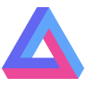
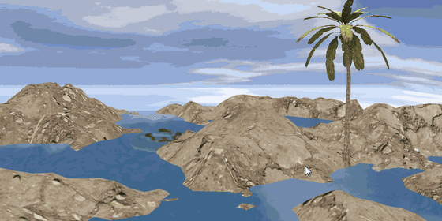
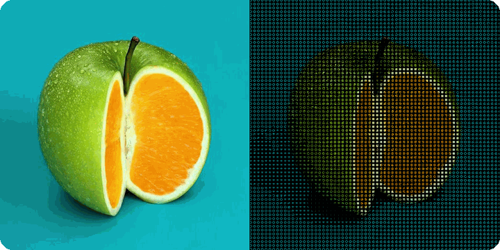
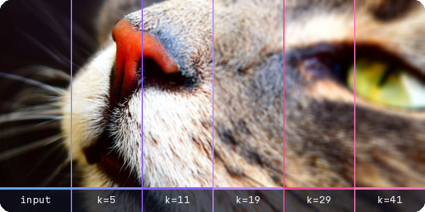
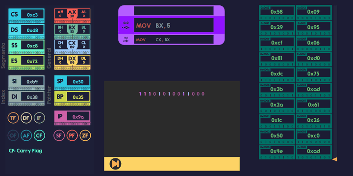
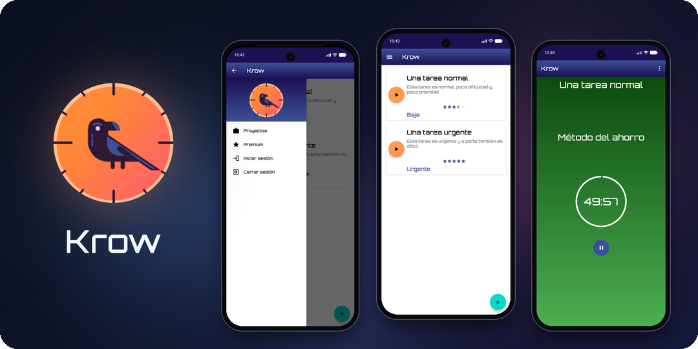
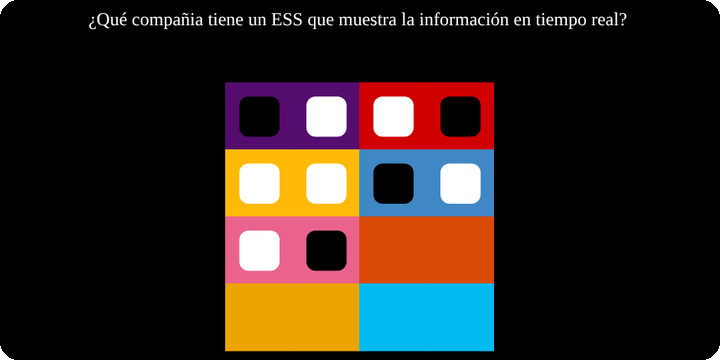
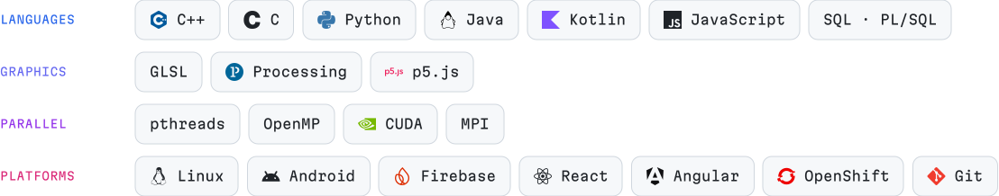

<picture>
  <source media="(prefers-color-scheme: dark)" srcset="assets/banner-dark.svg">
  
</picture>

  &nbsp;
  &nbsp;
  

I'm a software engineer from Colombia with **four years of production C++**, from passenger-data services at Amadeus to the cross-platform endpoint agent at Wazuh. I'm now pointing that systems background at **visual computing**: real-time graphics, image processing and computer vision.

<!--
=====================================================================
  WORK IN PROGRESS: uncomment this block once the piano repo is public.
  Put a short GIF of the live overlay at assets/projects/piano-fingering.gif (~560×280).
=====================================================================

## &nbsp; Now building

<table>
<tr>
<td width="48%" valign="top">
  
</td>
<td valign="top">
  
  <h3><a href="https://github.com/anromerom/REPO-NAME">Piano Fingering Tracker</a></h3>
  Personal project · 2026 – now
  
Watches a pianist's hands through a camera and labels which finger plays each key, with a live overlay as real-time feedback for learners.

  
<code>C++</code> <code>Python</code> <code>OpenCV</code>

</td>
</tr>
</table>
-->

## &nbsp; Selected projects

<table>
<tr>
<td width="50%" valign="top">
  
  <h3><a href="https://github.com/anromerom/unal-vc-water-shaders">Water Shaders</a></h3>
  Visual Computing · UNAL · 2020 · team of 3
  
Real-time lake water. Each frame renders the scene three times (mirrored camera for reflection, main camera for refraction, final view); a scrolling DuDv map adds ripples and a Fresnel term blends the two. <b>My part:</b> the water texturing and reflection demo.

  
<code>GLSL</code> <code>Processing</code> <code>Java</code> <code>nub</code>

</td>
<td width="50%" valign="top">
  
  <h3><a href="https://github.com/anromerom/unal-vc-ascii-art">ASCII Art &amp; Image Processing</a></h3>
  Visual Computing · UNAL · 2020 · team of 3
  
Filters for images and live video (luma, threshold, blur and edge-detection convolutions) plus an ASCII renderer that ranks glyphs by pixel coverage. Built on the CPU first, then again as GLSL fragment shaders.

  
<code>GLSL</code> <code>Processing</code> <code>Java</code>

</td>
</tr>
<tr>
<td width="50%" valign="top">
  <!-- TODO: link to a curated copy (e.g. anromerom/unal-pdc-parallel-blur) once it exists, like the other unal-* repos -->
  
  <h3><a href="https://github.com/Equipo-alfa-super-mega-dinamita/Paralela-y-distribuida">Parallel Image Blur</a></h3>
  Parallel &amp; Distributed Computing · UNAL · 2020 · team of 3
  
A box-blur convolution in C, parallelized four ways: POSIX threads, OpenMP, CUDA and MPI. Benchmarked on 720p, 1080p and 4K images with kernels from 3 to 15, reaching up to 3.2× speed-up on a 4-core i7. <b>My part:</b> the original blur kernel, the benchmark script and analysis notebook, and per-channel parallelism in the CUDA version.

  
<code>C</code> <code>pthreads</code> <code>OpenMP</code> <code>CUDA</code> <code>MPI</code>

</td>
<td width="50%" valign="top">
  
  <h3><a href="https://github.com/anromerom/unal-pl-vaca">VACA: Visual Assembly Code Analyzer</a></h3>
  Programming Languages · UNAL · 2019 · team of 3 · <a href="https://equipo-alfa-super-mega-dinamita.github.io/VACA-Project/">live demo</a>
  
A web IDE that parses 8086 assembly with an ANTLR grammar, runs it step by step and animates the registers, instruction queue, ALU and memory. <b>My part:</b> the p5.js CPU visualization.

  
<code>p5.js</code> <code>ANTLR 4</code> <code>React</code>

</td>
</tr>
<tr>
<td width="50%" valign="top">
  
  <h3><a href="https://github.com/anromerom/unal-mad-krow">Krow</a></h3>
  Mobile Development · UNAL · 2020 · team of 2
  
Android time-management app: plan tasks on a calendar, then work through them with Pomodoro, "saving" or "marathon" clocks. Room for local data, Firebase for accounts and sync. Built alongside <a href="https://github.com/anromerom/unal-mad-challenges">11 weekly Android challenges</a>.

  
<code>Kotlin</code> <code>Java</code> <code>Room</code> <code>Firebase</code>

</td>
<td width="50%" valign="top">
  
  <h3><a href="https://github.com/anromerom/unal-is-quiz-grille">Quiz Turning Grille</a></h3>
  Information Systems · UNAL · 2019 · solo
  
A classroom quiz whose answers form the key of a Fleissner turning-grille cipher. Answer everything correctly and the rotating grille reveals a hidden message; wrong answers give gibberish.

  
<code>p5.js</code> <code>JavaScript</code>

</td>
</tr>
</table>

## &nbsp; Experience

<table>
<tr>
  <td valign="top" width="120"><b>2025&nbsp;–&nbsp;now</b></td>
  <td><b>C/C++ Software Developer</b> · <a href="https://github.com/wazuh">Wazuh</a> · remote Cross-platform endpoint agent (Linux, Windows, macOS) of an open-source security platform.</td>
</tr>
<tr>
  <td valign="top" width="120"><b>2025</b></td>
  <td><b>Senior Application Software Developer</b> · RS2 Software · remote (Malta) Oracle PL/SQL for a payments back-office product.</td>
</tr>
<tr>
  <td valign="top" width="120"><b>2022&nbsp;–&nbsp;2025</b></td>
  <td><b>Associate Software Development Engineer</b> · Amadeus · Bogotá C++ REST/JSON services over Oracle that send airline passenger data to customs authorities; Angular monitoring app on OpenShift.</td>
</tr>
<tr>
  <td valign="top" width="120"><b>2021&nbsp;–&nbsp;2025</b></td>
  <td><b>Teaching Assistant &amp; Course Developer</b> · Universidad Nacional de Colombia Python MOOC, applied data analysis and visualization, and applied-AI courses for public-sector teams.</td>
</tr>
</table>

## &nbsp; Education

**B.Sc. Systems and Computing Engineering** · Universidad Nacional de Colombia, Bogotá · 2021
 Highlights: Visual Computing · Parallel &amp; Distributed Computing · Optimization · Intelligent Systems

## &nbsp; Toolbox

<picture>
  <source media="(prefers-color-scheme: dark)" srcset="assets/stack-dark.svg">
  
</picture>

Spanish (native) · English (C1)

